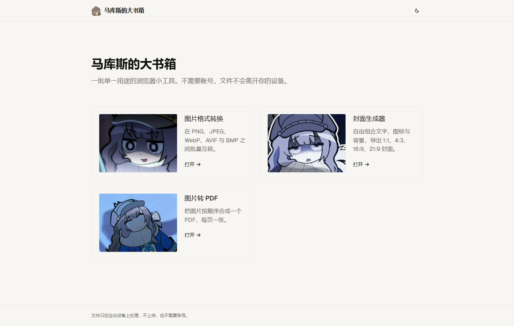

# Toolbox

[简体中文](./README.zh-CN.md)

[](https://github.com/makursi/toolbox/actions/workflows/ci.yml)

A collection of single-purpose browser tools, deployed at [toolbox-woad.vercel.app](https://toolbox-woad.vercel.app). Every Tool runs entirely in your browser: no account, and the files you give it stay on your device. The site is published as 马库斯的大书箱; the repository and its packages are `toolbox` and `@toolbox/*`.



_The homepage, with the three Tools it has today._

## Status

Maintained — the site is live, and each new Tool lands as its own pull request.

## Getting started

You need Node.js 22.12.0 or newer (CI runs Node 24) and pnpm 12.3.4, the version `packageManager` pins in `package.json`.

```bash
pnpm install
pnpm dev        # http://localhost:3000
```

**Open the site at the host the dev server prints.** Next allows `localhost` by default and rejects every other hostname, and it holds back hydration until its HMR socket connects, so a page loaded from a hostname it does not allow renders and then ignores every click. `apps/web/next.config.ts` adds the hostnames this project allows — `127.0.0.1` and the `10/8` LAN range, so a phone can reach the dev server — and is where this machine's own address goes when it is on another network. Verify interactive work against the production build for the same reason:

```bash
pnpm build
pnpm start
```

The browser gate needs its browser once per machine; `pnpm install` deliberately does not fetch it:

```bash
pnpm --filter @toolbox/web exec playwright install chromium
```

### Everyday commands

| Command             | Purpose                                    |
| ------------------- | ------------------------------------------ |
| `pnpm dev`          | Run the site                               |
| `pnpm build`        | Production build                           |
| `pnpm start`        | Serve the production build                 |
| `pnpm lint`         | Oxlint, type-aware                         |
| `pnpm lint:fix`     | Oxlint, type-aware, with `--fix`           |
| `pnpm typecheck`    | `tsc --noEmit`                             |
| `pnpm test`         | Vitest unit tests                          |
| `pnpm e2e`          | Browser gate: Playwright, production build |
| `pnpm fmt`          | Format the repository with Oxfmt           |
| `pnpm fmt:check`    | Verify formatting                          |
| `pnpm check:readme` | Check the two READMEs against each other   |
| `pnpm check:docs`   | Check the instruments' pointers both ways  |

## Usage

Open [toolbox-woad.vercel.app](https://toolbox-woad.vercel.app) and pick a Tool. Each one works in the page and writes its result to a download; nothing is uploaded. The three Tools today:

| Tool            | Route                    | What it does                                                               |
| --------------- | ------------------------ | -------------------------------------------------------------------------- |
| Image Converter | `/tools/image-converter` | Converts PNG, JPEG, WebP, AVIF and BMP in batches.                         |
| Cover Generator | `/tools/cover-generator` | Composes text, icons and a background into 1:1, 4:3, 16:9 and 21:9 covers. |
| Image to PDF    | `/tools/image-to-pdf`    | Puts one image on each page of a single PDF.                               |

## Configuration

`SITE_URL` is the canonical origin for metadata, `robots.txt` and `sitemap.xml`, and it is read on the server only. Copy `apps/web/.env.example` to `apps/web/.env.local`; unset, it falls back to `http://localhost:3000`, so local development needs no configuration.

| Name       | Meaning                               | Default                 | Example                           |
| ---------- | ------------------------------------- | ----------------------- | --------------------------------- |
| `SITE_URL` | Canonical origin of the deployed site | `http://localhost:3000` | `https://toolbox-woad.vercel.app` |

## Architecture

```
apps/web/          the only App: Next.js App Router and Tailwind CSS v4
  src/app/         routes; each Tool has its own static route at /tools/<slug>
  src/tools/       one directory per Tool (core/, worker/, hooks/, meta.ts), plus registry.ts
  src/components/  the shell and the site's own components; ui/ is the vendored Primitive layer
  e2e/             the gate: what the site does, with Playwright, on every pull request
  scripts/         the instruments: what a page draws, and how big a hit area is
  docs/            design.md (the entry) + design/ (one file per area), adding-a-tool.md
packages/          code shared across workspace packages (today: tsconfig only)
docs/adr/          decisions that are hard to reverse
docs/agents/       how agents file issues and read these docs
CONTEXT.md         the vocabulary: Tool, Package, App, Tool Registry
```

`apps/web` is the only deployable and imports from `packages/*`; no Package imports the App. A Tool is not a Package: its code lives in `src/tools/<slug>/`, and code moves to `packages/*` only when a second workspace package needs it. The homepage grid, navigation and sitemap all read `src/tools/registry.ts`, so a new Tool is one import there plus its directory.

An instrument measures and a gate asserts. `e2e/` blocks a pull request on what the site does; `scripts/` prints numbers about what it draws, and the hit-area instrument runs in CI too. The line between the two is drawn in [`docs/adr/0012-playwright-for-the-browser-gate.md`](docs/adr/0012-playwright-for-the-browser-gate.md), and the words are defined in [`CONTEXT.md`](CONTEXT.md).

## Documentation

- [`apps/web/docs/design.md`](apps/web/docs/design.md) — the entry to the design doc set: the invariants, the "what you are touching" routing table, and the directions already rejected. The modules under `apps/web/docs/design/` are written in Chinese.
- [`apps/web/docs/adding-a-tool.md`](apps/web/docs/adding-a-tool.md) — the contract for a new Tool: the gates, the files it touches, where its tests go, and the order of work.
- [`docs/adr/`](docs/adr/) — architecture decisions, one file each.
- [`CONTEXT.md`](CONTEXT.md) — the project's vocabulary.
- [`AGENTS.md`](AGENTS.md) — the repository conventions and the traps no check can see.
- [`docs/agents/`](docs/agents/) — how agents file issues and read these docs.

## Getting help

Bugs and feature requests go to [GitHub Issues](https://github.com/makursi/toolbox/issues); that is the only support channel.

## Contributing

The rules live in [`AGENTS.md`](AGENTS.md) rather than a separate `CONTRIBUTING.md`. Branch off `main` (a new Tool is `feat/<slug>`), write conventional commits in English, and run what CI runs before pushing:

```bash
pnpm fmt:check && pnpm check:readme && pnpm check:docs && pnpm lint && pnpm typecheck && pnpm test && pnpm build
```

Add `pnpm e2e` when a page changed; it builds first. CI runs the same checks plus the browser gate and the hit-area instrument. The pre-push hook only runs `lint` and `typecheck`, so "the hook passed" is not "the work is done".

## Licence

There is no `LICENSE` file, so the code is all rights reserved by default.

The supplied art is not covered by the repository's licence at all: forking this repo does not grant the right to reuse the site mark (`apps/web/assets/brand/makursi.png` and its three exports) or the Tool covers. See [`apps/web/docs/design/assets.md`](apps/web/docs/design/assets.md).
