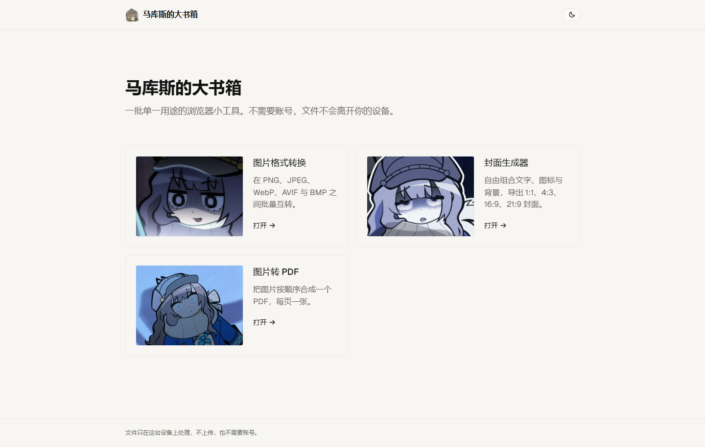

# Toolbox

[English](./README.md)

[](https://github.com/makursi/toolbox/actions/workflows/ci.yml)

一批单一用途的浏览器小工具，部署在 [toolbox-woad.vercel.app](https://toolbox-woad.vercel.app)。每个 Tool 都完整地跑在你的浏览器里：不需要账号，交给它的文件不会离开你的设备。站点对外叫「马库斯的大书箱」；仓库与它的 packages 是 `toolbox` 与 `@toolbox/*`。



_首页，目前有三个 Tool。_

## 状态

维护中——站点在线，每个新 Tool 单独一个 PR。

## 开始

需要 Node.js 22.12.0 或更新（CI 跑 Node 24），以及 pnpm 12.3.4——`package.json` 里 `packageManager` 钉住的版本。

```bash
pnpm install
pnpm dev        # http://localhost:3000
```

**请用 dev server 打印出来的那个 host 打开站点。** Next 默认放行 `localhost`，其他主机名一律拒绝；而且在它的 HMR socket 连上之前会一直压着 hydration，所以在它不认识的主机名上打开，页面会照常渲染、然后对每一次点击都不理不睬。`apps/web/next.config.ts` 里加上了本项目放行的那些主机名——`127.0.0.1` 与 `10/8` 网段，方便用手机访问 dev server——换到别的网络时，把这台机器的地址加进去。同样的原因，要验交互就对着生产构建来：

```bash
pnpm build
pnpm start
```

浏览器门禁的浏览器每台机器装一次；`pnpm install` 故意不下载它：

```bash
pnpm --filter @toolbox/web exec playwright install chromium
```

### 常用命令

| 命令                | 用途                              |
| ------------------- | --------------------------------- |
| `pnpm dev`          | 起站点                            |
| `pnpm build`        | 生产构建                          |
| `pnpm start`        | 跑生产构建                        |
| `pnpm lint`         | Oxlint，带类型信息                |
| `pnpm lint:fix`     | Oxlint，带类型信息，加 `--fix`    |
| `pnpm typecheck`    | `tsc --noEmit`                    |
| `pnpm test`         | Vitest 单元测试                   |
| `pnpm e2e`          | 浏览器门禁：Playwright 对生产构建 |
| `pnpm fmt`          | 用 Oxfmt 格式化整个仓库           |
| `pnpm fmt:check`    | 校验格式                          |
| `pnpm check:readme` | 校验两份 README 是否还对得上      |
| `pnpm check:docs`   | 双向校验量具的指针                |

## 用法

打开 [toolbox-woad.vercel.app](https://toolbox-woad.vercel.app)，挑一个 Tool。每个 Tool 都在页面里干活，结果落到一次下载里；不上传任何东西。现在有三个：

| 工具         | 路由                     | 做什么                                                     |
| ------------ | ------------------------ | ---------------------------------------------------------- |
| 图片格式转换 | `/tools/image-converter` | 在 PNG、JPEG、WebP、AVIF 与 BMP 之间批量互转。             |
| 封面生成器   | `/tools/cover-generator` | 自由组合文字、图标与背景，导出 1:1、4:3、16:9、21:9 封面。 |
| 图片转 PDF   | `/tools/image-to-pdf`    | 把图片按顺序合成一个 PDF，每页一张。                       |

## 配置

`SITE_URL` 是 metadata、`robots.txt` 与 `sitemap.xml` 用的正式来源，只在服务端读取。照 `apps/web/.env.example` 抄一份到 `apps/web/.env.local`；不设就退回 `http://localhost:3000`，所以本地开发不需要任何配置。

| 名字       | 含义               | 默认值                  | 示例                              |
| ---------- | ------------------ | ----------------------- | --------------------------------- |
| `SITE_URL` | 部署站点的正式来源 | `http://localhost:3000` | `https://toolbox-woad.vercel.app` |

## 架构

```
apps/web/          唯一的 App：Next.js App Router 与 Tailwind CSS v4
  src/app/         路由；每个 Tool 在 /tools/<slug> 有自己的静态路由
  src/tools/       每个 Tool 一个目录（core/、worker/、hooks/、meta.ts），外加 registry.ts
  src/components/  站点外壳与站点自己的组件；ui/ 是自带的 Primitive 层
  e2e/             门禁：站点「做什么」，Playwright，每个 PR 都跑
  scripts/         量具：页面「画成什么样」，以及真实可点区域有多大
  docs/            这个 App 自己的文档：design.md（入口）+ design/（各模块）、adding-a-tool.md
packages/          工作区各包之间共享的代码（目前只有 tsconfig）
docs/adr/          不轻易推翻的决定
docs/agents/       agent 怎么提 issue、怎么读这些文档
CONTEXT.md         词表：Tool、Package、App、Tool Registry
```

`apps/web` 是唯一的可部署物，从 `packages/*` 导入；没有 Package 反过来导入 App。Tool 不是 Package：它的代码在 `src/tools/<slug>/`，只有出现第二个工作区包需要它时，代码才移到 `packages/*`。首页网格、导航与 sitemap 都读 `src/tools/registry.ts`，所以加一个 Tool 就是在这里加一行 import、再加它的目录。

量具只测量，门禁才断言。`e2e/` 拿站点「做什么」挡住 PR；`scripts/` 打印它「画成什么样」的数字，命中区域量具也跑在 CI 里。两者的界线在 [`docs/adr/0012-playwright-for-the-browser-gate.md`](docs/adr/0012-playwright-for-the-browser-gate.md)，两个词的定义在 [`CONTEXT.md`](CONTEXT.md)。

## 文档

- [`apps/web/docs/design.md`](apps/web/docs/design.md) —— 设计文档集的入口：不变量、「你在动什么」路由表、已经否掉的方向。`apps/web/docs/design/` 下的各模块用中文写。
- [`apps/web/docs/adding-a-tool.md`](apps/web/docs/adding-a-tool.md) —— 加一个 Tool 的契约：要先过的门禁、要碰的文件、测试放哪、动手顺序。
- [`docs/adr/`](docs/adr/) —— 架构决策，一个文件一条。
- [`CONTEXT.md`](CONTEXT.md) —— 项目的词表。
- [`AGENTS.md`](AGENTS.md) —— 仓库约定，以及任何检查都看不见的坑。
- [`docs/agents/`](docs/agents/) —— agent 怎么提 issue、怎么读这些文档。

## 求助

Bug 与功能请求走 [GitHub Issues](https://github.com/makursi/toolbox/issues)；那是唯一的支持渠道。

## 贡献

约定在 [`AGENTS.md`](AGENTS.md) 里，而不是单独一份 `CONTRIBUTING.md`。从 `main` 开分支（新 Tool 用 `feat/<slug>`），commit 用英文的 conventional commits，push 之前跑一遍 CI 跑的东西：

```bash
pnpm fmt:check && pnpm check:readme && pnpm check:docs && pnpm lint && pnpm typecheck && pnpm test && pnpm build
```

动了页面就再加 `pnpm e2e`；它会先构建。CI 跑同一组检查，另外加浏览器门禁与命中区域量具。pre-push hook 只跑 `lint` 与 `typecheck`，所以「hook 过了」不等于「活干完了」。

## 许可

仓库没有 `LICENSE` 文件，所以代码默认保留所有权利。

外部素材完全不在这份许可的范围内：fork 这个仓库不会连带得到站点标记（`apps/web/assets/brand/makursi.png` 与它的三份导出）和工具封面的使用权。见 [`apps/web/docs/design/assets.md`](apps/web/docs/design/assets.md)。
